<a href="https://gustavo-dourado.gustavoaureliodev.workers.dev/">
  <picture>
    <source media="(prefers-color-scheme: dark)" srcset="https://readme-typing-svg.demolab.com?font=JetBrains+Mono&size=18&duration=3000&pause=2500&color=4ADE80&center=true&vCenter=true&width=640&lines=Sistemas+de+ponta+a+ponta%2C+do+banco+%C3%A0+tela;Agentes+de+IA+que+passam+para+um+humano+na+hora+certa;Dispon%C3%ADvel+para+S%C3%A3o+Paulo+(h%C3%ADbrido)+ou+remoto" />
    
  </picture>
</a>

  
  
  

No estágio na **Sunter Tecnologia**, desenvolvo CRM, pesquisas NPS com envio automático, login único (SSO) e agentes de IA. Também atuo como freelancer. 
Busco vagas full stack ou back-end, híbridas em São Paulo ou remotas. Moro em Salvador, BA, com disponibilidade para mudança.

### 🏡 O que cada projeto prova

| Projeto | O que prova |
|---|---|
| **[Portfólio com assistente](https://gustavo-dourado.gustavoaureliodev.workers.dev/)** | Um assistente de IA que responde recrutadores só com documentos aprovados, cita a fonte de cada frase e publica a própria avaliação. Cloudflare Workers + D1. |
| **[financeiro-rls](https://github.com/Gudoourado/financeiro-rls)** | Isolamento por usuário com RLS no PostgreSQL, testado e medido com `EXPLAIN ANALYZE`. |
| **[Agente Volta Zero](https://github.com/Gudoourado/agente-volta-zero)** | Atendimento de nível 1 com IA que passa para um humano, com o ticket pronto, quando a busca não tem confiança. [Demo](https://agente-volta-zero-kdhup6wqnhtgphtgnyptp6.streamlit.app/). |
| **[cerebro-avaliacao](https://github.com/Gudoourado/cerebro-avaliacao)** | Como avaliar uma busca BM25+ com casos sintéticos, piso de score e resultado caso a caso. |
| **APIs Java** · [finanças](https://github.com/Gudoourado/personal-finance-api) · [filmes](https://github.com/Gudoourado/movie-catalog-api) · [contatos](https://github.com/Gudoourado/contact-manager-api) | Java 17 + Spring Boot 3, erros tratados de forma consistente, testes e CI em Java 17 e 21. |

