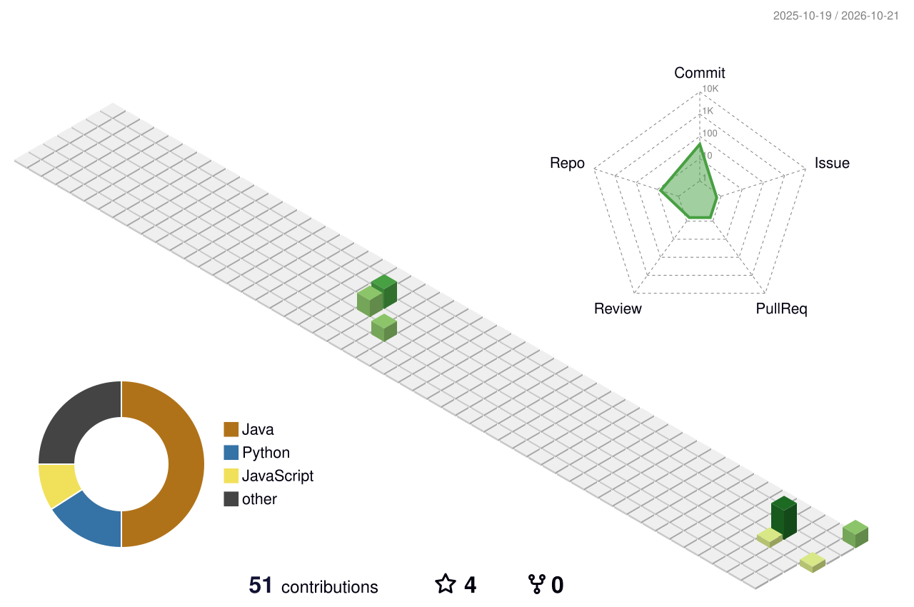

<div align="center">


<a href="https://gustavo-dourado.gustavoaureliodev.workers.dev/">
  
</a>

<p>
  <a href="https://gustavo-dourado.gustavoaureliodev.workers.dev/"></a>
  <a href="https://www.linkedin.com/in/gustavodoourado/"></a>
  <a href="mailto:gustavoaureliodev@gmail.com"></a>
</p>

</div>

```ts
const gustavo = {
  papel: "Desenvolvedor Full Stack, foco em back-end",
  hoje: ["Estágio full stack na Sunter Tecnologia", "Freelas full stack"],
  entregou: ["CRM", "pesquisa NPS com envio automático", "login único (SSO)", "agentes de IA"],
  base: "Salvador, BA · busco vaga híbrida em São Paulo ou remota",
  formacao: "Ciência da Computação, UNIFACS · conclusão no fim de 2026",
  idiomas: ["português", "inglês (7 meses de suporte na Irlanda)"],
};
```

### 🌱 Stack

<p align="center">
  <br/>
  
</p>

### ☁️ Em números

<p align="center">
  
  
</p>

<p align="center">
  
</p>

### 🏡 Projetos em destaque

<p align="center">
  <a href="https://github.com/Gudoourado/financeiro-rls"></a>
  <a href="https://github.com/Gudoourado/agente-volta-zero"></a>
  <a href="https://github.com/Gudoourado/cerebro-avaliacao"></a>
  <a href="https://github.com/Gudoourado/personal-finance-api"></a>
</p>

| Projeto | O que prova |
|---|---|
| **[Portfólio com assistente](https://gustavo-dourado.gustavoaureliodev.workers.dev/)** | Um assistente de IA que responde recrutadores só com documentos aprovados, cita a fonte de cada frase e publica a própria avaliação. Cloudflare Workers + D1. |
| **[financeiro-rls](https://github.com/Gudoourado/financeiro-rls)** | Isolamento por usuário com RLS no PostgreSQL, testado e medido com `EXPLAIN ANALYZE`. |
| **[Agente Volta Zero](https://github.com/Gudoourado/agente-volta-zero)** | Atendimento de nível 1 com IA que passa para um humano, com o ticket pronto, quando a busca não tem confiança. [Demo](https://agente-volta-zero-kdhup6wqnhtgphtgnyptp6.streamlit.app/). |
| **[cerebro-avaliacao](https://github.com/Gudoourado/cerebro-avaliacao)** | Como avaliar uma busca BM25+ com casos sintéticos, piso de score e resultado caso a caso. |
| **APIs Java** · [finanças](https://github.com/Gudoourado/personal-finance-api) · [filmes](https://github.com/Gudoourado/movie-catalog-api) · [contatos](https://github.com/Gudoourado/contact-manager-api) | Java 17 + Spring Boot 3, erros tratados de forma consistente, testes e CI em Java 17 e 21. |

<div align="center">


</div>
